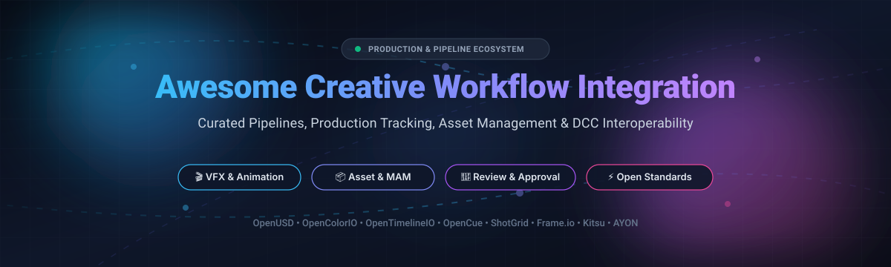

# Awesome Creative Workflow Integration 🎬✨

  

  
  
  
  
  

---

## 🚀 Overview & Mission

> **A curated, battle-tested directory of SaaS products, pipeline interchange formats, and open-source ecosystems designed for animation, VFX, games, virtual production, and post-production studios.**

Modern digital content creation (DCC) pipelines demand seamless interoperability between editing suites, 3D DCC tools (Maya, Houdini, Blender), compositors (Nuke, Fusion, After Effects), review portals, and asset management platforms. This list indexes industry standards and open-source tools that streamline shot tracking, scene interchange, asset resolution, frame-accurate review, automated rendering, and round-trip workflows.

---

## 📑 Table of Contents

- [📊 Sector Overview & Market Dynamics](#-sector-overview--market-dynamics)
- [💼 SaaS & Commercial Hosted Platforms](#-saas--commercial-hosted-platforms)
- [🌟 Open-Source GitHub Projects](#-open-source-github-projects)
  - [Open-Source Pipeline Comparison & Star Rankings](#open-source-pipeline-comparison--star-rankings)
  - [Architectural Frameworks for Custom Pipelines](#architectural-frameworks-for-custom-pipelines)
- [🤝 How to Contribute](#-how-to-contribute)
- [💖 Support & Sponsorship](#-support--sponsorship)
- [📈 Star History](#-star-history)
- [⚖️ Disclaimer](#-disclaimer)

---

## 📊 Sector Overview & Market Dynamics

The **creative workflow, media asset management (MAM), and production tracking** software sector commands an estimated global valuation of **$10B to $15B**, exhibiting a compound annual growth rate (**CAGR**) of **~11–12%**. Growth is catalyzed by distributed remote VFX teams, 4K/8K media pipelines, virtual production environments, and demand for automated multi-channel content delivery.

The market structure features **moderate consolidation** at the top tier:
- **Ecosystem Giants:** Mega-cap tech vendors like **Apple** and **Adobe** dominate non-linear editing (NLE), motion graphics, and integrated dynamic linking. **Autodesk** acts as the enterprise anchor for 3D modeling, animation, and cloud-based shot tracking (**Flow Production Tracking / ShotGrid**).
- **Specialized Pipeline & Open-Source Fragmenation:** The workflow layer remains vibrant and distributed. Studios frequently combine commercial applications with specialized open interchange standards (OpenUSD, OpenColorIO, OpenTimelineIO) and self-hosted open-source trackers/managers (Kitsu, AYON/OpenPype, OpenCue, FreeFrame) to maintain sovereignty over proprietary IP, custom schemas, and private storage backends.

---

## 💼 SaaS & Commercial Hosted Platforms

| Company Scale (Revenue / Valuation) | Product | Overview & Workflow Capability | Starting Price Tier | Free Tier / Trial Specifications |
| :--- | :--- | :--- | :--- | :--- |
| **~$3.0T+ Market Cap** (~$391B Rev) | **[Apple Final Cut Pro + Compressor](https://www.apple.com/final-cut-pro/)** | Native macOS video editing paired with deep Compressor linking for automated batch encoding, delivery specifications, and media asset pipelines. | $299.99 one-time perpetual (Final Cut Pro) + $49.99 (Compressor); or $12.99/mo via Apple Creator Studio bundle | 30-day free trial (integrated via Apple Creator Studio); 1-month free trial on iPadOS |
| **~$220B+ Market Cap** (~$21.4B Rev) | **[Adobe Dynamic Link](https://www.adobe.com/products/premiere/features.html)** | Seamless inter-application linking between Premiere Pro, After Effects, and Adobe Audition for zero-render round-tripping of compositions and audio stems. | $22.99/mo (Single App annual paid monthly) or $59.99/mo (Creative Cloud All Apps) | 7-day free trial with unrestricted desktop access and cloud library syncing (limit: 1 trial per user) |
| **~$220B+ Market Cap** (~$21.4B Rev) | **[Frame.io](https://frame.io/)** | Cloud-native media review and approval suite featuring frame-accurate comments, visual annotations, side-by-side version comparison, and NLE plugins. | $15/user/month (Pro plan billed monthly, $13/user/month billed annually) | Free-forever plan limited to 2 team members, 2 active projects, 2 GB cloud storage, and 1080p web playback |
| **~$65B+ Market Cap** (~$6.1B Rev) | **[Autodesk Flow Production Tracking (ShotGrid)](https://www.autodesk.com/products/flow-production-tracking)** | The de-facto enterprise production management standard for VFX, animation, and AAA games, managing task schedules, shot lists, asset lifecycles, and client review via RV. | $50/user/month (monthly billing) or $33/user/month ($390/user/year billed annually) | 30-day fully functional free trial with production tracking, shot/asset databases, and RV media player integration |
| **~$3B Valuation** (~$576M Rev) | **[Blackmagic Fusion Studio / DaVinci Resolve Fusion Connect](https://www.blackmagicdesign.com/products/fusion)** | Node-based 3D compositing, motion design, and rotoscoping tightly linked into DaVinci Resolve timelines for fluid VFX and DI color grading integration. | $295 one-time perpetual license (includes standalone Fusion Studio and full DaVinci Resolve Studio) | Free-forever tier (DaVinci Resolve) capped at UHD 3840x2160 export, 60 fps, single GPU, excluding Neural Engine AI tools and advanced Resolve FX |
| **~$3B Valuation** (~$576M Rev) | **[DaVinci Resolve Studio Integrations](https://www.blackmagicdesign.com/products/davinciresolve)** | Unified post-production application combining editing, Fusion VFX, Fairlight audio, and industry-standard color grading under a shared project database. | $295 one-time perpetual license (lifetime license with free version updates) | Free-forever tier (DaVinci Resolve) capped at UHD 3840x2160 export, 60 fps, single GPU, excluding Neural Engine AI tools and advanced Resolve FX |
| **~$1.4B Valuation** (~$417M Rev) | **[Avid Interplay / MediaCentral](https://www.avid.com/products/interplay)** | Production asset management (PAM) and shared storage orchestration engineered for broadcast networks and multi-room enterprise post facilities. | Starting at $23.99/mo (Media Composer Standard) to $49.99/mo (Media Composer Ultimate); MediaCentral/Interplay PAM infrastructure via custom enterprise quote | 30-day full trial for Media Composer Ultimate; enterprise MediaCentral/Interplay PAM requires direct vendor demo and guided proof-of-concept |
| **~$665M Valuation** (~$85M Rev) | **[Nuke Studio Workflow](https://www.foundry.com/products/nuke)** | Conforming, editorial review, and shot-management framework directly inside Foundry Nuke Studio, connecting editorial cuts to distributed node-graph scripts. | $499/year (Nuke Indie for artists earning under $200k/year); $6,379/year (Full commercial Nuke Studio subscription) | 30-day unrestricted free trial of full Nuke Studio suite; unlimited non-commercial version capped at 1080p render output with watermarking |
| **~$200M+ PE Backing** (~$5M Rev) | **[ftrack Studio](https://www.ftrack.com/)** | Cloud project tracking, resource scheduling, and synchronized interactive media review platform tailored for animation, games, and boutique VFX studios. | $25/user/month (billed annually) or $30/user/month (billed monthly) for ftrack Studio | 14-day free trial with complete tracking functionality, 250 GB review storage, and unlimited free external client review links |
| **~$8M–$12M Rev** (Privately held) | **[Boris FX Mocha Pro Link](https://borisfx.com/products/mocha-pro/)** | Planar tracking, PowerMesh warped surface tracking, rotoscoping, and lens calibration tool bridging directly to Nuke, After Effects, and Resolve. | $48/mo or $325/year (Single-Host plug-in); $64/mo or $435/year (Multi-Host license) | 14-day full feature free trial with complete tracking/mesh solve toolset; reverts to watermarked / restricted output mode upon expiration |

---

## 🌟 Open-Source GitHub Projects

The visual effects and animation industries rely heavily on open-source standards to maintain vendor neutrality and data autonomy. Below are the top open-source creative pipeline projects, **ranked by GitHub Stars in descending order**:

### Open-Source Pipeline Comparison & Star Rankings

1. **[Pixar OpenUSD (Universal Scene Description)](https://github.com/PixarAnimationStudios/OpenUSD)**   
   *Universal Scene Description (USD) is an extensible, high-performance software system for authoring, composing, reading, and streaming robust, layered 3D computer graphics data across varied DCC applications.*

2. **[OpenImageIO (OIIO)](https://github.com/AcademySoftwareFoundation/OpenImageIO)**   
   *Academy Software Foundation standard library providing format-agnostic APIs for reading, writing, and processing image formats and textures in VFX, animation, and rendering pipelines.*

3. **[OpenColorIO (OCIO)](https://github.com/AcademySoftwareFoundation/OpenColorIO)**   
   *Complete color management solution targeted towards motion picture production with emphasis on visual effects, computer animation, ACES color pipelines, and multi-app consistency.*

4. **[OpenTimelineIO (OTIO)](https://github.com/AcademySoftwareFoundation/OpenTimelineIO)**   
   *Open-source API and interchange format for editorial timeline and conform information. Bridges editorial cuts between Final Cut Pro, Premiere Pro, Avid, Resolve, and VFX shot databases.*

5. **[OpenCue](https://github.com/AcademySoftwareFoundation/OpenCue)**   
   *Scalable, battle-tested open-source render farm and workload management system originally created by Sony Pictures Imageworks, governing multi-facility compute clusters.*

6. **[Kitsu](https://github.com/cgwire/kitsu)**   
   *Modern, self-hostable collaboration and production tracking web application for animation and VFX studios. Tracks assets, shots, tasks, client playlists, and team casting.*

7. **[TACTIC](https://github.com/Southpaw-TACTIC/TACTIC)**   
   *Highly configurable dynamic enterprise workflow and Digital Asset Management (DAM) system engineered for complex digital production environments and automated content routing.*

8. **[Prism Pipeline](https://github.com/PrismPipeline/Prism)**   
   *Artist-friendly pipeline automation suite for VFX and 3D animation. Handles folder hierarchies, DCC export presets, playblasts, and shot publishing for Blender, Maya, Houdini, and 3ds Max.*

9. **[OpenAssetIO](https://github.com/OpenAssetIO/OpenAssetIO)**   
   *Open-source interoperability standard bridging DCC tools and asset management backends via persistent entity references instead of hardcoded file paths.*

10. **[OpenPype / AYON](https://github.com/ynput/OpenPype)**   
    *Comprehensive studio pipeline framework connecting Maya, Nuke, Houdini, Unreal Engine, and Kitsu into a synchronized publishing, versioning, and asset retrieval architecture.*

11. **[FreeFrame](https://github.com/Techiebutler/freeframe)**   
    *Self-hostable open-source video review and approval alternative to Frame.io, offering frame-accurate timecode scrubbing, drawing annotations, and team review channels.*

12. **[Zou (Kitsu Backend API)](https://github.com/cgwire/zou)**   
    *High-performance Python/Flask backend and PostgreSQL REST API driving Kitsu, enabling pipeline TDs to query shot data, automate approvals, and trigger background tasks.*

---

### Architectural Frameworks for Custom Pipelines

When building an enterprise-grade studio pipeline from scratch using open-source building blocks:
- **Production Tracking & Editorial**: Use **Kitsu** & **Zou** for shot metadata and approvals; integrate **OpenTimelineIO (OTIO)** for continuous conform synchronization between editorial and VFX departments.
- **DCC Publishing & Tool Integration**: Deploy **AYON / OpenPype** or **Prism Pipeline** to standardize publishing across Blender, Maya, Houdini, and Nuke.
- **Interchange & Asset References**: Adopt **Pixar OpenUSD** for scene description layers and **OpenAssetIO** to decouple asset resolvers from filesystem structures.
- **Color Pipeline & Imaging**: Enforce **OpenColorIO (OCIO)** color configurations and rely on **OpenImageIO (OIIO)** for cross-format proxy and texture conversion.
- **Compute & Farm Execution**: Power multi-machine rendering and simulation workloads with **OpenCue**.

---

## 🤝 How to Contribute

We welcome contributions from pipeline technical directors, artists, and software developers worldwide! 🌍

1. **Fork** the repository: `git checkout -b feature/new-pipeline-tool`
2. **Add / Update** entries in `README.md` keeping the Markdown table and star badge standards intact.
3. Ensure every commercial product includes verified **starting tier pricing** and explicit **free tier/trial limitations**.
4. Ensure open-source projects include official URLs and the standard star badge syntax.
5. **Commit** and submit a **Pull Request** with a concise description of your changes.

---

## 💖 Support & Sponsorship

If this curated pipeline directory saved you and your studio hours of research, please consider supporting the project:

- ⭐ **Star this repository** to improve discoverability for other TDs and pipeline developers.
- 🍴 **Fork and share** with colleagues in animation, VFX, and post-production communities.
- ☕ **Support continuous development and curation**: You can sponsor or buy a coffee via the official [GitHub Sponsor Dashboard](https://github.com/sponsors/ishandutta2007).

Thank you to all community contributors, studio engineers, and open-source maintainers who make flexible creative pipelines possible! 🙌

---

## 📈 Star History

---

## ⚖️ Disclaimer

- This list is **community-curated** for educational and architectural reference only; it does not constitute an official commercial endorsement.
- Studio production pipelines govern sensitive IP, massive storage footprints, and unforgiving client milestones. Always test plugins, database schemas, and render farm schedulers thoroughly in staging environments before rolling them out into active productions.

---

  <b>Built with ❤️ for Pipeline TDs, VFX Supervisors, Post-Production Engineers, and Open-Source Creators worldwide.</b>

